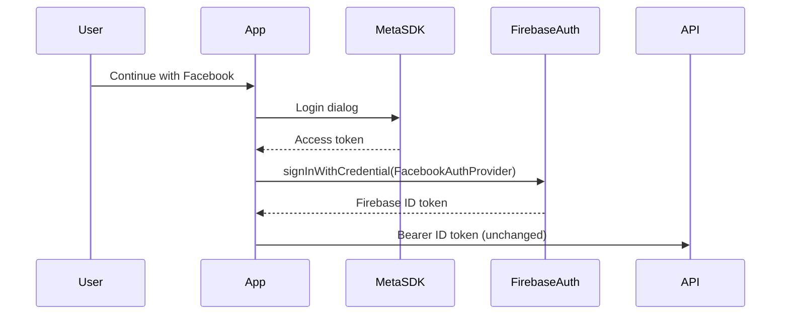

# Facebook login — implementation plan (deferred)

**Status:** Not scheduled for implementation. PRD still lists Facebook as omitted (FR-ONB-010/011); prototype includes “Continue with Facebook” on signup/login. Use this doc when picking up the feature.

**Related:** [requirements.md](../product/requirements.md) (FR-AUTH-006), [La_Nonna_Onboarding_Prototype.html](../prototype/La_Nonna_Onboarding_Prototype.html), [development.md](development.md) (auth).

---

## What you need (Meta + Firebase) — read this first

Facebook login is **not** just an app button. Meta and Firebase must trust each other before any Flutter code works on a real device.

### 1. Meta Developer (developers.facebook.com)

| Item | What it is |
|------|------------|
| **Meta app** | Container for “Facebook Login” product on Android + iOS (and optionally Web). |
| **App ID** | Public identifier (e.g. `1234567890`) — goes in mobile native config and Firebase. |
| **App secret** | **Server-only** — entered in **Firebase Console** only, never in the Flutter repo. |
| **Client token** | Recommended for mobile SDK (Meta → Settings → Advanced); goes in Android `strings.xml` / iOS `Info.plist`. |
| **Android** | Add package name `com.lanonna.lanonna`, **key hashes** (debug + release/upload keystore). Without correct hashes, login fails on device. |
| **iOS** | Bundle ID matching Runner, enable “Facebook Login”, configure URL scheme `fb{APP_ID}`. |
| **App mode** | Starts in **Development** (only test users). **Live** mode needs Meta **App Review** for `email` / `public_profile` (typical for Firebase). |
| **Privacy** | Privacy Policy URL + data deletion callback URL (Meta requirement for Live). |

**Cost/time:** Creating the app is free; review can take days. You can develop with **Facebook test users** in Development mode without Live.

### 2. Firebase (lanonna-dev project)

1. Authentication → Sign-in method → **Facebook** → Enable.
2. Paste **App ID** + **App secret** from Meta.
3. Copy Firebase’s **OAuth redirect URI** back into Meta → Facebook Login → Settings → Valid OAuth Redirect URIs (Firebase docs show the exact URL).

No API/worker/DB changes: backend already verifies Firebase ID tokens ([development.md](development.md) auth flow).

### 3. Local / CI secrets (mirror Google)

Today Google uses [`flavors/dev.json`](../../apps/mobile/flavors/dev.json) (`GOOGLE_SIGN_IN_SERVER_CLIENT_ID`). Plan the same pattern:

- `FACEBOOK_APP_ID` (and optionally `FACEBOOK_CLIENT_TOKEN`) via `--dart-define-from-file=flavors/dev.json`
- Document in [`flavors/README.md`](../../apps/mobile/flavors/README.md) + `dev.json.example` (no secrets in git)
- **Hide the Facebook button** when `FACEBOOK_APP_ID` is empty so dev builds without Meta setup still work (recommended)

---

## Product / PRD alignment (required when shipping)

Current requirements **intentionally omit** Facebook (FR-ONB-010/011, FR-AUTH-006, social auth table).

When implementing, update:

- New or extend **FR-AUTH-008**: Facebook sign-in/sign-up, same Firebase user model, skips email verify like Google.
- FR-ONB-010/011: remove “Facebook omitted”; note button order matches prototype (Google, then Facebook, then email).
- Out-of-scope / social auth summary line.

---

## Implementation scope (mobile)

### Auth layer — [`auth_repository.dart`](../../apps/mobile/lib/core/auth/auth_repository.dart)

Mirror Google:

- Add `flutter_facebook_auth`.
- `signInWithFacebook()` → `LoginResult` → `FacebookAuthProvider.credential(accessToken: …)` → `signInWithCredential`.
- `usesFacebookProvider` (`facebook.com` in `providerData`).
- `reauthenticateWithFacebook()` for delete-account (parallel to `reauthenticateWithGoogle`).
- `signOut()` → `FacebookAuth.instance.logOut()` in addition to Google + Firebase.

Optional: small `facebook_sign_in_config.dart` like [`google_sign_in_config.dart`](../../apps/mobile/lib/core/config/google_sign_in_config.dart).

### UI — prototype parity

Prototype: **Google → Facebook → “or sign up with email”**.

- New `OnboardingFacebookButton` + blue “f” mark (SVG under `assets/branding/`, same pattern as [`google_logo_mark.dart`](../../apps/mobile/lib/core/widgets/google_logo_mark.dart)).
- Wire on signup/login screens: `_facebook()` → `navigateAfterOnboardingAuth(..., usedOAuth: true)`.
- Shared busy state: disable both social buttons while either runs.

### Account safety — [`delete_account_screen.dart`](../../apps/mobile/lib/features/account/presentation/delete_account_screen.dart)

Extend `_reauthenticateIfSupported()` for `usesFacebookProvider` → `reauthenticateWithFacebook()`.

### Copy / i18n

- `app_en.arb`: `emailVerifyOAuthNote` → social wording (Google/Facebook).
- Complete profile OAuth subtext already generic enough; rename `googlePhoto` local to `oauthPhotoUrl` for clarity only.

### Errors

- Map Facebook cancel/fail in [`auth_error_message.dart`](../../apps/mobile/lib/core/auth/auth_error_message.dart).

### Native config

| Platform | Changes |
|----------|---------|
| **Android** | `res/values/strings.xml` (`facebook_app_id`, `fb_login_protocol_scheme`, `facebook_client_token`); `AndroidManifest.xml` `com.facebook.sdk.ApplicationId` meta-data; `queries` for Facebook package if required by SDK version. |
| **iOS** | `Info.plist`: `FacebookAppID`, `FacebookClientToken`, `FacebookDisplayName`, URL scheme `fb{APP_ID}`, `LSApplicationQueriesSchemes`. |

### Tests

- Auth repository tests with mock/fake Facebook auth wrapper.
- `onboarding_login_screen_test.dart` / `onboarding_facebook_button_test.dart`.
- `delete_account_screen_test.dart` for Facebook reauth branch.

### Docs (at implementation time)

- `development.md`: Auth section — Facebook flavor keys, Firebase + Meta checklist, key hash commands.

---

## Out of scope for first ship of this feature

- Apple Sign-In (still “later” in PRD).
- Backend schema or token format changes.
- Facebook button visible without `FACEBOOK_APP_ID` configured.
- Meta App Review submission (ops before production Live mode).

---

## Suggested execution order

1. **Ops:** Create Meta app, enable Facebook Login, add Android/iOS platforms, test users, enable Facebook in Firebase dev, fill `flavors/dev.json` with App ID (+ client token).
2. **Code:** Auth repo + buttons + delete reauth + native templates + feature flag when App ID missing + tests + PRD/docs.
3. **Verify:** Real device; sign up → complete profile → home; sign out; delete-account reauth; invite wrong-email if Facebook email differs from invitee.
4. **Later:** Meta App Review + Live mode before public beta with Facebook.

---

## Regression risks

| Risk | Mitigation |
|------|------------|
| Sign-in without Meta config crashes | Guard button / `signInWithFacebook` when App ID empty |
| Account deletion blocked for Facebook users | Reauth branch + tests |
| Email verify shown for Facebook users | Keep `usedOAuth: true` + `markOAuthSignIn()` |
| Invite email mismatch | Existing wrong-email flow; Facebook users may lack email on token — test with Meta permissions |

---

## Pickup options

- **A)** Create Meta + Firebase dev config, then implement the code path (recommended for end-to-end test).
- **B)** Implement code-first with hidden Facebook button until `FACEBOOK_APP_ID` is set (configure Meta later).

---

## Checklist (copy when starting work)

- [ ] Meta Developer app + Facebook Login (Android/iOS)
- [ ] Firebase Auth Facebook provider + redirect URI in Meta
- [ ] `FACEBOOK_APP_ID` / client token in local `flavors/dev.json`
- [ ] Mobile auth + UI + delete reauth + native config
- [ ] PRD + engineering docs + tests
- [ ] Device QA on real hardware
