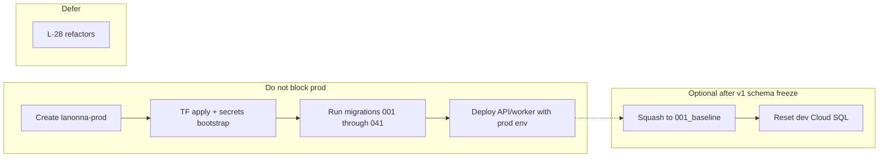

# Pre-prod consolidation strategy

| Field | Value |
|-------|--------|
| **Status** | Planning (not yet executed) |
| **Last updated** | 2026-10-20 |
| **Related** | [operations.md](operations.md), [open-gaps.md](open-gaps.md) (L-28, M-47, M-52), [migrations README](../../infra/db/migrations/README.md) |

**Summary:** Do not delay `lanonna-prod` for a migration squash or L-28 refactors. Run the existing migration chain (`001`–`041_biometric_credentials`) on a fresh prod DB (minutes, safe). Optionally squash to one baseline later when you reset dev. Prioritize small, prod-wiring consolidations (deploy/env, Terraform secrets, IAM scripts) before or in parallel with the prod project.

## Execution plan (2026-10-20)

Single PR, repo-only (no GCP project creation). Analysis and design first; implementation follows existing script/Terraform patterns.

| Step | Deliverable | Notes |
|------|-------------|--------|
| 1 | `scripts/lib/env.sh` | Derive `ENVIRONMENT` from `GCP_PROJECT_ID` (`lanonna-dev` → `dev`, `lanonna-prod` → `prod`, any other project fails; `ENVIRONMENT=prod` without the prod project fails; a mismatched `ENVIRONMENT` fails); default project `lanonna-dev` preserves Mac dev deploys. |
| 2 | `infra/env/prod.{api,worker}.env` | Mirror dev shape; prod-only unknowns use `__…__` placeholders that deploy scripts reject. |
| 3 | Deploy scripts | API/worker load `infra/env/<env>.*.env` by default; `ENVIRONMENT` on Cloud Run matches resolution. |
| 4 | `scripts/apply-run-iam.sh` | Rename from `apply-dev-run-iam.sh`; update docs/CI/cursor rules. |
| 5 | Terraform `sql_secrets.tf` + FCM in `iam.tf` | When `manage_sql_app_password=true` (prod only today), write `db-lanonna-app-password` secret version once; dev keeps `manage_sql_app_password=false` so existing passwords are untouched. Document dev import for FCM binding; SQL password-in-state risk in [open-gaps.md](open-gaps.md) M-60. |
| 6 | `scripts/setup-schedulers.sh` | Merge weekly digest + expired-invite schedulers (scripts remain source of truth — not in TF). |
| 7 | Hosting | `hosting/.firebaserc` prod alias; `deploy-invite-hosting.sh` uses env helper; prod requires explicit `ANDROID_SHA256` (no debug keystore). Preview rewrite needs API `--allow-unauthenticated` (no Firebase Hosting SA IAM — [rca/repo-email-scrub-and-hosting-iam.md](rca/repo-email-scrub-and-hosting-iam.md)). |
| 8 | Docs | `operations.md` prod env files + two-phase prod TF apply; `open-gaps.md` + checklist updates; fix migration count references to **41**. |

**Dev equivalence:** Unchanged default `GCP_PROJECT_ID=lanonna-dev` → same committed env files and `ENVIRONMENT=dev` once `infra/env/dev.worker.local.env` exists (one-time copy from `dev.worker.local.env.example` with the real Mailjet sender). Cloud Run env vars unchanged after deploy.

## Recommendation (short)

| Approach | Verdict |
|----------|---------|
| **Squash migrations → 1 before creating prod** | **Not required.** Fresh prod applies [`apply_migrations.py`](../../infra/db/apply_migrations.py) over empty Cloud SQL; backfill migrations (e.g. `032`–`039`) are **no-ops** on empty data. Cost of squash: large diff, review risk, doc/CI updates—benefit: slightly faster apply and less history noise. |
| **Squash after you reset dev** | **Reasonable optional cleanup** if you are OK wiping dev. Best done **once** schema is stable for v1 launch (after `041`), not as a gate for prod. |
| **L-28 code consolidation** ([open-gaps.md](open-gaps.md) L-28) | **Defer** until post-launch or quiet cycles—explicitly “medium risk, live request paths.” |
| **Prod-wiring “consolidation”** | **Do**—these reduce copy-paste and prod footguns without refactoring domain logic. |

## Tracking checklist

- [ ] Create `lanonna-prod` and apply existing migrations `001`–`041` on empty Cloud SQL (no squash gate)
- [x] Add `infra/env/prod.api.env` / `prod.worker.env`, fix `ENVIRONMENT` in deploy scripts (M-52), TF SQL password → Secret Manager (M-47), generalize `apply-run-iam.sh` — merged in #347
- [x] Mobile prod flavor + Crashlytics wiring ([mobile-prod-flavor-and-crashlytics.md](mobile-prod-flavor-and-crashlytics.md); owner still: keystore, `flutterfire configure`, fill `flavors/prod.json`)
- [ ] (Optional, after schema freeze) Generate `001_baseline_v1.sql`, archive `002`–`040`, reset dev DB, add schema-only diff check in CI
- [ ] Keep L-28 refactors and email-tree merge out of pre-prod scope

---

## 1. Database migrations

### How it works today

- [`infra/db/apply_migrations.py`](../../infra/db/apply_migrations.py): lexicographic `*.sql`, skip if `schema_migrations.version` exists.
- Each file self-registers via `INSERT INTO schema_migrations` (see [`001_app_users.sql`](../../infra/db/migrations/001_app_users.sql)).
- [`scripts/verify-dev-migrations.sh`](../../scripts/verify-dev-migrations.sh): **file count must equal row count** in `schema_migrations` (currently 41).

### Why squashing is not a prod prerequisite

- Prod has **no rows**; running 40 incremental files is fast and already tested on dev.
- Several files are **data repair** for dev history (`025`, `031`–`039`). On empty DB they still run safely (mostly `UPDATE`/`DELETE` affecting 0 rows).
- A squashed file must reproduce **final DDL + indexes + constraints** exactly; one mistake blocks all new environments.

### If you still want a single baseline (dev reset OK)

Do this **after** prod is up or in the same window as a planned dev wipe—not instead of prod:

1. **Freeze schema:** no new migrations until squash is done.
2. **Generate baseline** from a DB that has all 41 applied (dev after proxy):
   - `pg_dump --schema-only --no-owner` (or use Cloud SQL export), then hand-edit: keep `schema_migrations` table, end with `INSERT INTO schema_migrations (version) VALUES ('001_baseline_v1')`.
   - **Omit** dev-only backfill DML from the baseline; keep only final `CREATE`/`ALTER`/indexes/constraints.
3. **Replace migration set:**
   - Move `002`–`041` to `infra/db/migrations/archive/pre_baseline/` (read-only audit trail) **or** delete with pointer in [migrations README](../../infra/db/migrations/README.md).
   - Single active file: e.g. `001_baseline_v1.sql`.
4. **Reset environments:** drop/recreate `lanonna` DB on dev (and only use baseline on **new** prod if prod was not already migrated—if prod already ran the incremental chain, **do not** squash prod in place without a deliberate migration strategy).
5. **Update tooling:** `verify-dev-migrations.sh` expected count = 1; Postgres integration tests that assume specific migration files (grep `infra/db/migrations` in tests).
6. **Going forward:** new changes are `002_add_foo.sql`, etc.

**Risk control:** add a one-off CI job or script that compares `pg_dump --schema-only` of “baseline apply” vs the full incremental chain on empty Postgres (Docker) and diffs—only merge squash when identical.

---

## 2. Consolidate before prod (high value, low risk)

These are “make prod and dev symmetric” tasks, not refactors.

| Item | Why | Main files |
|------|-----|------------|
| **Prod env files** | Today only [`infra/env/dev.api.env`](../../infra/env/dev.api.env) / [`dev.worker.env`](../../infra/env/dev.worker.env). Prod needs explicit min instances, sender, etc. | Add `infra/env/prod.api.env`, `prod.worker.env`; document in [operations.md](operations.md) |
| **Deploy `ENVIRONMENT` + project** (M-52) | [`services/api/scripts/deploy.sh`](../../services/api/scripts/deploy.sh) and [`services/worker/scripts/deploy.sh`](../../services/worker/scripts/deploy.sh) hardcode `ENVIRONMENT=dev` while buckets use `GCP_PROJECT_ID` | Derive `ENVIRONMENT` from `project_id` (`lanonna-prod` → `prod`) or require explicit flag; load `API_ENV_FILE` / worker env by environment |
| **SQL password → Secret Manager** (M-47) | Prod TF sets password in [`sql.tf`](../../infra/terraform/modules/platform/sql.tf) but not `db-lanonna-app-password` version | Extend [`secrets.tf`](../../infra/terraform/modules/platform/secrets.tf) or documented bootstrap script |
| **Generalize Run IAM script** | Former `apply-dev-run-iam.sh` | Renamed to [`scripts/apply-run-iam.sh`](../../scripts/apply-run-iam.sh) (PR `cursor/pre-prod-wiring-0549`) |
| **Prod Terraform push subs** (M-19) | [`environments/prod/main.tf`](../../infra/terraform/environments/prod/main.tf) lacks `enable_worker_push_subscription` until worker exists | Document two-phase apply in operations (already in `terraform.tfvars.example`) |
| **Mobile prod flavor** | Not a “cleanup” but blocks prod binaries | `flavors/prod.json`, `flutterfire configure`, manifest/entitlements hosts—not dev hard-codes in [`AndroidManifest.xml`](../../apps/mobile/android/app/src/main/AndroidManifest.xml) / [`Runner.entitlements`](../../apps/mobile/ios/Runner/Runner.entitlements) |

**Suggested order:** create prod project → TF apply → bootstrap secrets → migrations (existing chain) → worker deploy → IAM script → enable push subs → API deploy with `prod.*.env` and `APP_CHECK_ENFORCE=true` when ready.

---

## 3. Do not consolidate before prod

| Area | Reason |
|------|--------|
| **L-28 backlog** (shared comment domain, router boilerplate, Terraform `for_each` on push subs, scheduler merge) | Refactor risk; no prod blocker |
| **Duplicate email trees** (`packages/email-templates` vs worker copy) | Intentional; [`sync-email-templates.sh`](../../scripts/sync-email-templates.sh) + L-16 |
| **H-04 worker OIDC in-app** | Security hardening—ship with prod if time allows, but not a prerequisite to *create* the project |
| **Squashing migrations** | Optional hygiene after schema freeze + dev reset—not required for correct prod schema |

---

## 4. Consolidate in parallel or soon after prod (medium priority)

| Item | Notes |
|------|--------|
| **FCM IAM in Terraform** (M-50) | ✅ `iam.tf` + dev import in [operations.md](operations.md) |
| **Scheduler scripts** | ✅ [`scripts/setup-schedulers.sh`](../../scripts/setup-schedulers.sh); Cloud Scheduler stays in scripts, not Terraform |
| **Hosting / Firebase CLI** | ✅ prod alias in [`hosting/.firebaserc`](../../hosting/.firebaserc); `deploy-invite-hosting.sh` uses env helper + prod `ANDROID_SHA256` |
| **Crashlytics** | ✅ Wired in mobile ([mobile-prod-flavor-and-crashlytics.md](mobile-prod-flavor-and-crashlytics.md)); enable in Firebase console per project |
| **open-gaps.md cleanup** | Close or re-tag items fixed by prod wiring |

---

## 5. What we would not do

- **Big-bang “consolidation sprint”** before prod (migration squash + L-28 + signing + legal)—that delays launch without reducing prod risk if you run the existing migration chain on empty SQL.
- **Replace incremental migrations on prod after it has data** without a formal cutover plan.

---

## 6. Practical decision

1. **Create `lanonna-prod` now** and apply **existing** `001`–`041` on fresh Cloud SQL.
2. Land **deploy/env + M-47 + IAM script rename** (see PR `cursor/pre-prod-wiring-0549`).
3. **After v1 schema freeze** (no pending DDL for a few weeks), optionally **squash to `001_baseline_v1`** and **reset dev**—keeps one migration file for the greenfield era without blocking prod.
